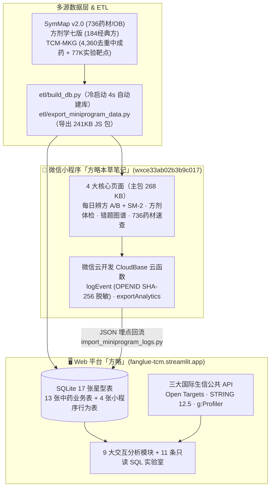

<p align="center">
  
</p>

<h1 align="center">🌿 方略 · 中药方剂配伍、网络药理学与双端增长分析平台</h1>

<p align="center">
  <strong>「微信小程序前台（高频辨方刷题 + 真实埋点与 A/B 实验） × Web 科研与增长看板（数据挖掘 + 网络药理学 + SQL 数仓）」</strong>
</p>

<p align="center">
  <a href="https://fanglue-tcm.streamlit.app"></a>
  
  
  
  
</p>

---

## 🔗 在线产品矩阵

| 端侧 | 产品名称 | 访问方式 / 标识 | 核心定位与价值 |
|---|---|---|---|
| **🖥️ Web 科研与分析端** | **方略数据分析平台** | 👉 **https://fanglue-tcm.streamlit.app** | 面向中医药学生与科研新手的一站式数据挖掘、网络药理学流水线与小程序增长实验看板（9 大交互页面） |
| **📱 微信小程序端** | **方略本草笔记**（简称 `方略本草`） | 微信搜「方略本草笔记」 / AppID `wxce33ab02b3b9c017`（已完成工信部备案与微信认证，类目：`教育服务 > 教育信息展示`） | 手机端高频刷题（SM-2 遗忘曲线 + Jaccard 相似方辨析 A/B 实验）、184 经典方体检、736 味药材速查与卡片分享裂变 |
| **📦 开源代码仓库** | **fanglue-tcm-analytics** | 👉 **https://github.com/xixiyu954/fanglue-tcm-analytics** | 全链路 Monorepo：ETL 清洗与导出、11 条生产级分析 SQL、9 页 Web 应用、原生小程序与微信云开发云函数 |

> **合规与科研边界声明**：本双端项目严格定位为**中医药教材学习、数据挖掘与科研辅助工具**，网络药理学计算结果仅作机制研究假设，**不提供任何临床诊疗、问诊或处方建议**。

---

## 🎯 项目解决的真实痛点与核心亮点

1. **多源中医药数据治理与偏差控制**
   - 整合 **SymMap v2.0**、《中国药典》、《方剂学》七版与 **TCM-MKG（Zenodo）**，建成 **17 张规范化 SQLite 数据表**：覆盖 **736 味标准药材**（286 味含药典用量、93 味含妊娠标注、6 味含马兜铃酸肾毒警示）、**1,251 条别名与炮制品标准化规则**（原始 767 种药名归并为 592 种，未匹配药名 **0**、重复记录 **0**）、**4,544 首方剂**与 **44,843 条组成记录**。
   - **主动消除多剂型采样偏差**：发现 TCM-MKG 原始 8,977 条中成药中存在大量「同名不同剂型（胶囊/颗粒/口服液/片/丸）」，直接挖掘会严重虚增药对支持度；在 ETL 中完成剂型归一去重，清洗保留 **4,360 首独立中成药处方**（叠加 184 首跨东汉—清经典名方），去重过程透明写入首页数据质量报告。
2. **SQL 索引性能调优与跨队列配伍洞察**
   - 将大规模自连接 `09_中成药高频药对.sql` 从无索引 CTE 扫描优化为直接命中 `idx_fh_formula` 索引连接，**4.3 万条组成记录查询耗时从 ~110s 降至 0.27s（提速 400×）**。
   - 挖掘出药典中成药高提升度经典药对：**乳香 + 没药**（共现 149 首，提升度 **18.47**）、**六神曲 + 麦芽**（**13.01**）、**山楂 + 麦芽**（**8.54**）；经典名方高提升度药对：**泽泻 + 猪苓**（**18.40**）、**薄荷 + 连翘**（**14.60**）、**羌活 + 防风**（**11.95**）。
3. **跨朝代定量验证学术流派演变**
   - 对跨东汉至清代的 184 首经典名方计算剂量加权寒热指数，**Kruskal-Wallis 非参数检验 $H = 16.83,\; p = 0.0099$**（存在统计学显著差异），定量印证从东汉经方偏温散到清代温病学派兴起偏寒凉清润的历史演变趋势，并主动在报告中说明「教材选方偏倚」局限。
4. **网络药理学一键流水线（专业壁垒）**
   - 本地整合 **605 味药材 → 2,153 种具名活性成分（QED / Lipinski / OB）→ 77,177 条实验验证靶点关系（覆盖 10,079 个人类基因）**，实时对接 **Open Targets**（疾病靶点 + 超几何检验）、**STRING v12.5**（人类 PPI 互作 + Hub 拓扑排名）与 **g:Profiler**（GO/KEGG 富集），绘制「药材 → 成分 → 靶点 → 通路」四层桑基图，每一步结果支持一键导出 CSV。
   - 实测案例：**「四君子汤 × 溃疡性结肠炎」**数秒内筛出 118 个活性成分、88 个交集靶点、51 条高置信（≥0.7）PPI 互作边，Top 3 KEGG 通路精准命中 `Inflammatory bowel disease`（$p = 6.78 \times 10^{-5}$）。
5. **微信小程序 × 后台数仓：真实增长闭环与 A/B 实验**
   - 补齐纯 PC 网页端“低频使用 + 刷新重置 `session_id` 无法算真实留存”的短板，原生开发 **「方略本草笔记」微信小程序**（主包仅 **268.1 KB**，内含 241.5 KB 离线数据包与微信云开发 `CloudBase` 云函数，服务端对真实 `OPENID` 做 SHA-256 单向脱敏）。
   - 小程序内置 **50/50 确定性 A/B 实验分流**（A 组按教材章节顺序出题，B 组基于预计算 **Jaccard 相似方矩阵**推送易混淆方辨析题）+ **SM-2 遗忘曲线复习** + 微信群卡片分享裂变；回流至后台第 9 页看板执行 **SRM 分流卡方检验、D7 留存双样本 Z 检验、复测正确率 Welch t 检验、Cohort 留存热力图、Aha Moment 归因、Jaccard 相似度 vs 实际错误率 Spearman 相关性验证与裂变 K 因子拆解**。

---

## 🏗️ 双端一体化架构



---

## 📊 Web 平台九大功能模块（`fanglue-tcm.streamlit.app`）

| 导航分组 | 模块 | 回答的核心分析问题 | 方法 / 统计检验 |
|---|---|---|---|
| 平台总览 | 🌿 数据总览与质量报告 | 数据规模、清洗去重前后对比与治理透明度？ | 别名归一率、剂型去重统计、缺失与超量校验 |
| 方剂数据挖掘 | 🩺 方剂体检 | 任意方剂的寒热性味归经与配伍风险如何？ | 剂量加权寒热指数、归经雷达、十八反/十九畏/马兜铃酸/妊娠校验、Jaccard 相似方 |
| 方剂数据挖掘 | 🔗 配伍规律挖掘 | 经典名方与 4,360 首中成药的核心药组与特异性用药？ | 帕累托、类 TF-IDF 特异性倍数、Apriori（支持度/置信度/提升度）、Louvain 社区发现 |
| 方剂数据挖掘 | 🧩 方剂聚类 | 仅凭药物组成聚类，与教材功效分类一致吗？ | Jaccard 距离、层次聚类、MDS 二维投影、调整兰德指数（ARI） |
| 方剂数据挖掘 | 🏯 古方朝代演变 | 东汉至清代的寒热与功效演变是否印证学术流派？ | 历史时期趋势、窗口函数 Top 5、Kruskal-Wallis 与卡方独立性检验 |
| 分子机制分析 | 🧬 网络药理学 | 方剂通过哪些活性成分、Hub 靶点与通路起效？ | QED/OB/Lipinski、超几何检验、STRING PPI 拓扑、g:Profiler GO/KEGG、四层桑基图 |
| 工程与产品分析 | 📱 小程序增长与 A/B 实验 | Jaccard 相似辨析策略能否显著提升 7 日留存与复测正确率？ | SRM 卡方校验、D7 留存 Z 检验、Welch t 检验、Cohort 热力图、Spearman 相关性、K 因子 |
| 工程与产品分析 | 🧪 SQL 实验室 | 如何用 SQL 完成多表聚合、索引自连接与留存计算？ | 11 条只读分析 SQL + 17 张表完整数据字典 |
| 工程与产品分析 | 📈 Web 行为分析 | Web 端访问转化漏斗与回访特征如何？ | 会话级 4 步转化漏斗、页面偏好、日活与 `LAG()` 回访 |

---

## 🗄️ 11 条面试向分析 SQL 清单（[`sql/`](sql/)）

| 文件 | 业务问题 | 核心 SQL 技能点 |
|---|---|---|
| [`01_各类别高频药材.sql`](sql/01_各类别高频药材.sql) | 各功效类别 Top 3 核心药材及使用率 | CTE、多表聚合、`RANK() OVER (PARTITION BY ...)` |
| [`02_各朝代Top5药材.sql`](sql/02_各朝代Top5药材.sql) | 经典名方各朝代高频药材 Top 5 | 队列口径过滤、`ROW_NUMBER()` 分组取 TopN |
| [`03_药对共现与提升度.sql`](sql/03_药对共现与提升度.sql) | 经典名方药对支持度、置信度、提升度 | 索引自连接（`a.herb < b.herb`）、派生指标 |
| [`04_方剂寒热指数.sql`](sql/04_方剂寒热指数.sql) | 184 首经典名方剂量加权寒热指数与分档 | `COALESCE` 缺失兜底、加权均值、`CASE WHEN` 分档 |
| [`05_剂量超范围检查.sql`](sql/05_剂量超范围检查.sql) | 自动检出超出药典常用量区间的记录 | 区间质量规则校验、比值排序 |
| [`06_用户漏斗.sql`](sql/06_用户漏斗.sql) | Web 端四步转化漏斗（访问→分析→导出） | 会话级去重、条件聚合、`UNION ALL` 漏斗 |
| [`07_会话回访.sql`](sql/07_会话回访.sql) | 会话活跃天数与次日回访间隔 | `LAG()` 窗口函数、`JULIANDAY` 日期差 |
| [`08_网络药理靶点覆盖.sql`](sql/08_网络药理靶点覆盖.sql) | 各药材类药活性成分与实验靶点覆盖 Top 25 | 三表关联、条件去重计数 `COUNT(DISTINCT CASE ...)` |
| [`09_中成药高频药对.sql`](sql/09_中成药高频药对.sql) | 4,360 首中成药大规模高频药对与提升度 | 利用 `idx_fh_formula` 索引自连接（110s → 0.27s） |
| [`10_小程序留存Cohort.sql`](sql/10_小程序留存Cohort.sql) | 小程序按注册日期的 D1/D3/D7/D14+ Cohort 留存 | 跨事实表去重活跃日、Cohort 留存标准 SQL |
| [`11_AB实验与混淆分析.sql`](sql/11_AB实验与混淆分析.sql) | A/B 两组答题量、复测正确率、耗时与活跃天数 | 先按用户粒度聚合再求组均值（消除刷量偏差） |

---

## 📁 仓库目录结构

```text
fanglue-tcm-analytics/
├── streamlit_app.py                  # Web 平台统一入口（st.navigation 9 页面 + 云端自动建库）
├── requirements.txt / Dockerfile     # Streamlit Cloud / Hugging Face Spaces 部署配置
├── DEPLOY.md                         # 公网部署与日常同步说明
├── data/raw/                         # 压缩原始与清洗数据（总计 < 2.5 MB，4s 自动构建 SQLite）
├── etl/
│   ├── expand_datasets.py            # SymMap v2.0 + 方剂学 + TCM-MKG 剂型去重与标准化
│   ├── build_netpharm_data.py        # 605 药材 → 2,153 化合物 → 77,177 靶点 + Open Targets 预缓存
│   ├── build_db.py                   # 构建 17 张 SQLite 表与索引
│   ├── export_miniprogram_data.py    # 导出小程序 241.5 KB 离线 JS 数据包与 Jaccard 矩阵
│   └── import_miniprogram_logs.py    # 导入小程序/云开发 JSON 埋点日志至星型数仓
├── sql/                              # 11 条生产级分析 SQL（01–11）
├── app/
│   ├── core/                         # db.py · analysis.py · netpharm.py · tracking.py · ui.py
│   └── views/                        # 9 个交互分析页面（含 network_pharmacology & miniprogram_growth）
├── wechat-miniprogram/               # 📱 微信小程序「方略本草笔记」完整工程
│   ├── project.config.json           # 已绑定 AppID wxce33ab02b3b9c017
│   ├── avatar_fanglue.png            # 定制 512×512 草本典籍徽章图标
│   ├── miniprogram/                  # 4 大页面（quiz / check / mistakes / profile）+ utils + data
│   ├── cloudfunctions/               # 微信云开发云函数（logEvent / exportAnalytics）
│   └── 上线与审核指南.md               # 个人主体注册、云开发开通、备案与审核清单
└── reports/分析报告模板.md            # 作品集 8 章节数据分析报告成稿模板
```

---

## 🚀 本地运行与二次开发

### 1. 运行 Web 数据分析平台
```powershell
python -m venv .venv
.\.venv\Scripts\activate
pip install -r requirements.txt
python etl/build_db.py          # 可选：首次启动 streamlit 时也会自动在 4 秒内建库
streamlit run streamlit_app.py
```

### 2. 运行微信小程序「方略本草笔记」
1. 使用**微信开发者工具**导入 `wechat-miniprogram/` 目录（主包 268.1 KB，离线即用）；
2. 如需开启云端实时埋点，开通微信云开发并部署 `cloudfunctions/logEvent` 与 `exportAnalytics`，在 `miniprogram/app.js` 填入云环境 ID（详见 [`wechat-miniprogram/上线与审核指南.md`](wechat-miniprogram/上线与审核指南.md)）。

---

## 📝 简历项目写法参考 & 2 分钟面试演示脚本

### 简历表述（数据分析岗 / 数据产品岗通用）
> **「方略」中药方剂配伍、网络药理学与双端增长分析平台**｜独立设计开发  
> Web 平台：https://fanglue-tcm.streamlit.app ｜微信小程序：`方略本草笔记`（已备案认证）｜GitHub：https://github.com/xixiyu954/fanglue-tcm-analytics
> - **多源数据治理与 SQL 调优**：整合 SymMap v2.0、《方剂学》经典名方及 TCM-MKG 构建 17 张 SQLite 星型/业务表，编写 1,251 条药名别名与炮制标准化规则（0 未匹配）；识别并完成 8,977 条中成药同名不同剂型去重（保留 4,360 首独立处方），并通过索引自连接优化将 4.3 万条记录药对提升度查询耗时从 ~110s 降至 0.27s（400×）。
> - **统计挖掘与跨学科壁垒**：使用 Python + 11 条 SQL 实现帕累托、类 TF-IDF 特异性用药、Apriori 关联规则、Louvain 社区发现、层次聚类（ARI）与跨东汉—清朝代寒热演变检验（Kruskal-Wallis $p = 0.0099$）；搭建网络药理学一键流水线，联动 Open Targets / STRING 12.5 / g:Profiler 公共 API，输出超几何显著性、PPI 核心靶点与四层调控桑基图。
> - **小程序双端闭环与 A/B 实验**：针对 PC 端低频与留存失真痛点，独立上线原生微信小程序「方略本草笔记」（主包 268 KB，支持 SM-2 遗忘曲线、Jaccard 相似方辨析与微信云开发脱敏埋点），在后台看板落地 **50/50 A/B 实验评估（SRM 校验、D7 留存 Z 检验、Welch t 检验）、Cohort 留存热力图、Aha Moment 归因、Jaccard 相似度与混淆率 Spearman 相关性验证及裂变 K 因子分析**。

### 面试 2 分钟现场演示动线
1. **30s 展示数据治理与专业深度**：打开 Web 首页质量报告（讲 8,977→4,360 剂型去重与 1,251 别名规则）→ 切「方剂体检」输入带禁忌的方子看多级预警；
2. **45s 展示跨学科王炸**：切「🧬 网络药理学」直接看「四君子汤 × 溃疡性结肠炎」超几何检验、STRING PPI 核心靶点与四层桑基图；
3. **45s 展示互联网数分能力**：打开手机微信「方略本草笔记」演示相似方辨析刷题 → 切 Web「📱 小程序增长与 A/B 实验」讲解 SRM 校验、D7 留存 Z 检验、Cohort 热力图与「SQL 实验室」0.27s 索引自连接调优故事。

---

## 📚 数据来源与开源许可

- **SymMap v2.0**（Wu et al., *Nucleic Acids Research* 2019）：药材主表（`SMHB`）及化合物名称与口服生物利用度（`SMIT`）。
- **TCM-MKG**（Zenodo [23202835](https://zenodo.org/records/23202835)，CC-BY-NC-4.0）：药典口服中成药组成及实验验证的饮片—化合物—靶点基因映射。
- **《方剂学》七版经典名方整理**（参考 [YuanZHAO321/TCM.Skill](https://github.com/YuanZHAO321/TCM.Skill)，CC BY-NC 4.0）。
- **Open Targets Platform**、**STRING v12.5**、**g:Profiler**：实时调用公开学术生物信息 API。
